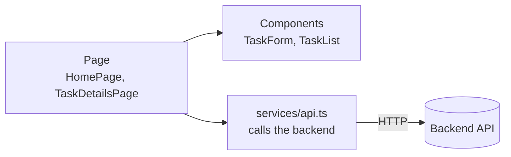
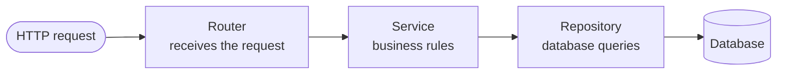

# Smarter Todo

A task app for students: keep your own to-do list, and share task lists with your team for group projects. Built as a REST API with FastAPI and a React frontend, deployed on Vercel.

> **Status:** MVP done; Beta in progress. Sign up, log in, private tasks and a profile page work (`/api/v1/auth`, `/api/v1/users/me`, `/api/v1/tasks`). Roles with an admin dashboard, group tasks and security hardening are planned next.

## Features

**MVP** (demo before mid-term)
- Create, list, view, update, complete and delete tasks through a REST API (`/api/v1/tasks`)
- Input validation with clear error responses
- Interactive API docs at `/api/docs`

**Beta** (demo before final)
- Sign up, log in, log out (JWT access token + refresh token cookie)
- Personal tasks: each user sees only their own
- Profile page: change your name and password
- Group tasks: create a group, add members, share and assign tasks
- Roles: `user` and `admin`; admin dashboard with stats, ban / unban users
- Security: Argon2 password hashing, login lockout, secure cookies, security headers

## Tech stack

| Part | Choice |
|---|---|
| Backend | Python 3.10+, FastAPI, SQLModel |
| Database | Supabase PostgreSQL (production), SQLite (local) |
| Frontend | React + TypeScript + Vite |
| Hosting | Vercel (frontend and backend in one project) |
| Beta extras | Alembic (migrations), PyJWT, pwdlib (Argon2) |

## Documentation

| Doc | What it covers |
|---|---|
| [PRD — Product Requirements Document](docs/01-prd.md) | Goals, features, user stories, milestones |
| [SRS — Software Requirements Specification](docs/02-srs.md) | Functional and non-functional requirements, permissions, acceptance criteria |
| [TDD — Technical Design Document](docs/03-tdd.md) | Architecture, data model, API endpoints, auth and security design |

## Project structure

```
backend/    FastAPI app (routes under /api)
frontend/   Vite + React + TypeScript
docs/       PRD, SRS, TDD (product requirements, software requirements, technical design)
vercel.json Vercel setup: /api/* goes to backend, everything else to frontend
AGENTS.md   Branch, commit and PR conventions
```

## How it works

### Frontend



A page shows the screen and keeps its data, components draw the pieces, and `services/api.ts` is the only place that talks to the backend.

### Backend



Each layer has one job: the router handles HTTP, the service decides what is allowed (for example, no due date in the past), and the repository reads and writes the database. The response goes back up the same way.

### Logging in

```mermaid
flowchart LR
    login["Log in<br/>email and password"] --> tokens["Server answers with<br/>access token + refresh cookie"]
    tokens --> call["Every request sends<br/>Authorization: Bearer token"]
    call --> me["Server finds the user<br/>and shows only their tasks"]
```

The access token (15 minutes) is kept in memory and sent with each request. The refresh token (7 days) is a random value in an `HttpOnly` cookie; when the access token expires, `services/api.ts` swaps it for a new pair without asking you to log in again.

## Requirements

- [Python](https://www.python.org/downloads/) 3.10+
- [Node.js](https://nodejs.org/) 22+

> On macOS/Linux, use `python3` instead of `python`.

## Run locally

You need two terminals: one for the backend and one for the frontend. Todos are saved in a local SQLite file, `backend/smarter_todo.db`, which is created by `alembic upgrade head` and is not committed.

### First time (initial setup)

Run this once after cloning the repo.

**Backend** (terminal 1):

```bash
cd backend
python -m venv .venv
.venv\Scripts\Activate.ps1      # macOS/Linux: source .venv/bin/activate
pip install -r requirements.txt
alembic upgrade head           # creates the database tables
fastapi dev main.py
```

Sign up in the app, then log in; every task belongs to your account.

**Frontend** (terminal 2):

```bash
cd frontend
npm install
npm run dev
```

### Running again (after the initial setup)

The virtual environment and `node_modules` already exist, so skip the install steps.

**Backend** (terminal 1):

```bash
cd backend
.venv\Scripts\Activate.ps1      # macOS/Linux: source .venv/bin/activate
alembic upgrade head           # only needed after pulling a change that adds a migration
fastapi dev main.py
```

**Frontend** (terminal 2):

```bash
cd frontend
npm run dev
```

Run `pip install -r requirements.txt` or `npm install` again only when someone adds or changes a dependency.

Open http://localhost:5173. Vite forwards `/api` requests to the backend on port 8000. API docs: http://localhost:8000/docs.

To run it the way Vercel does instead, from the project root:

```bash
npm install -g vercel
vercel dev -L
```

> Add new Python packages to `backend/requirements.txt`.

> **Reset the data:** stop the backend, delete `backend/smarter_todo.db` and run `alembic upgrade head` again.

### Changing the database (migrations)

The tables are created and changed only by Alembic migrations in `backend/alembic/versions/`; the app never creates tables itself. Run `alembic upgrade head` from `backend/` to apply them.

To migrate the hosted Supabase database, run it from your machine **before** merging code that needs the new schema, with the session pooler URL (port `5432`):

```bash
MIGRATION_DATABASE_URL="<supabase session pooler url>" alembic upgrade head    # PowerShell: $env:MIGRATION_DATABASE_URL="..."
```

> `MIGRATION_DATABASE_URL` wins over `DATABASE_URL`. Remove it from your shell afterwards, or a later local `alembic` command will change the hosted database.

## Environment variables

Locally nothing needs to be set: the app uses the SQLite file `backend/smarter_todo.db`. In production (Vercel) the app uses Supabase PostgreSQL. Set variables in Vercel under **Project → Settings → Environment Variables** (a local `.env` is never committed).

| Variable | Needed for | Notes |
|---|---|---|
| `DATABASE_URL` | MVP (production) | Supabase transaction pooler URL (port `6543`), e.g. `postgresql+psycopg://postgres.<ref>:<password>@aws-0-<region>.pooler.supabase.com:6543/postgres`. Leave unset locally to use SQLite. Vercel cannot keep a SQLite file between requests, so without a hosted database the deployed app loses its data. |
| `POSTGRES_URL` | MVP (production) | Set automatically by the Supabase integration on Vercel. Used when `DATABASE_URL` is not set; `postgres://` and the Supabase-only `supa=` parameter are handled for you. |
| `JWT_SECRET` | Auth (production) | Long random string, e.g. `python -c "import secrets; print(secrets.token_urlsafe(48))"`. **Required on Vercel** (logging in fails without it); locally a fixed development value is used. |
| `ACCESS_TOKEN_MINUTES` | Auth | Default `15` |
| `REFRESH_TOKEN_DAYS` | Auth | Default `7` |
| `MIGRATION_DATABASE_URL` | Migrations only | Supabase session pooler URL (port `5432`) used when you run Alembic against the hosted database. Not set on Vercel. |

Never commit secrets or `.env` files. See [TDD, section 8](docs/03-tdd.md#8-configuration) for the Supabase setup.

## Deploy to Vercel

1. Push the repo to GitHub.
2. Go to https://vercel.com/new, import the repo and click **Deploy**. Keep **Root Directory** as `./`.

Every push to `main` redeploys automatically. Or deploy from your machine with `vercel --prod`.

## Contributing

Every change starts from a GitHub issue. Branch, commit and pull request rules are in [AGENTS.md](AGENTS.md):

- Branch: `sayef/#{issue_number}-{task_title}`
- Commit: `<type>: <summary> (#issue)`, e.g. `feat: add task CRUD endpoints (#4)`
- One pull request per issue, with `Closes #{issue_number}` in the description

## Troubleshooting

- **"Running scripts is disabled" in PowerShell:** run `Set-ExecutionPolicy -Scope CurrentUser RemoteSigned`.
- **`fastapi` not found:** activate the virtual environment first.
- **`ModuleNotFoundError: sqlmodel`:** run `pip install -r requirements.txt` inside the activated virtual environment.
- **Todos look wrong or the database is corrupted:** stop the backend, delete `backend/smarter_todo.db` and run `alembic upgrade head`.
- **`no such table` or `Request failed: 500` right after pulling:** run `alembic upgrade head` in `backend/`.
- **Everything redirects to the login page:** log in or sign up first; tasks and the profile need an account.
- **Login works but you are logged out on reload (Safari):** the refresh cookie is `Secure`; use Chrome or Firefox on `http://localhost`, or open the app over HTTPS.
- **`Request failed: 500` in the app:** the backend isn't running.
- **App at localhost:8000 shows an old version:** delete `frontend/dist`.
- **Vercel build fails:** check **Build Logs** in the Vercel dashboard, and make sure `npm run build` works in `frontend/`.
