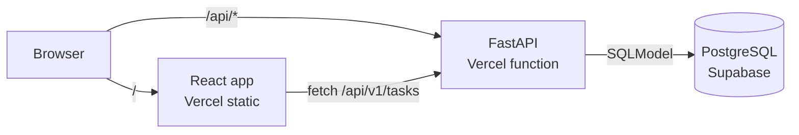
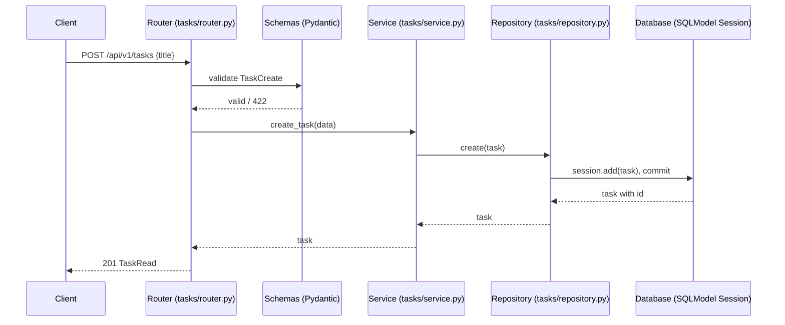
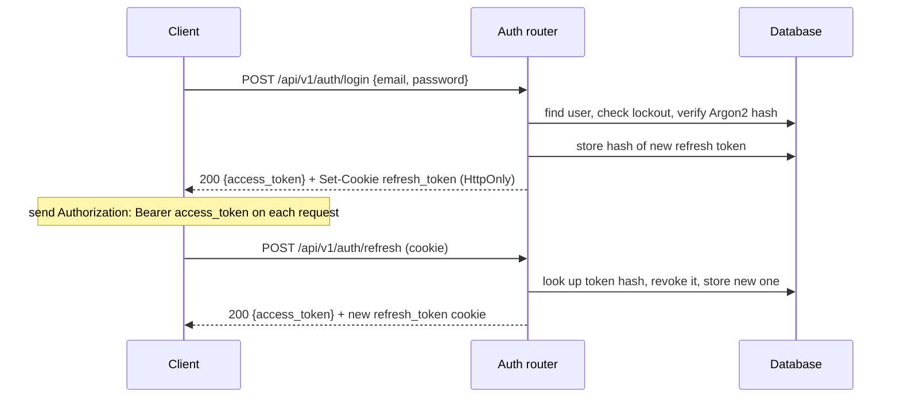
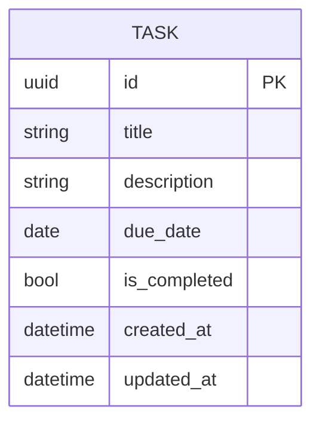
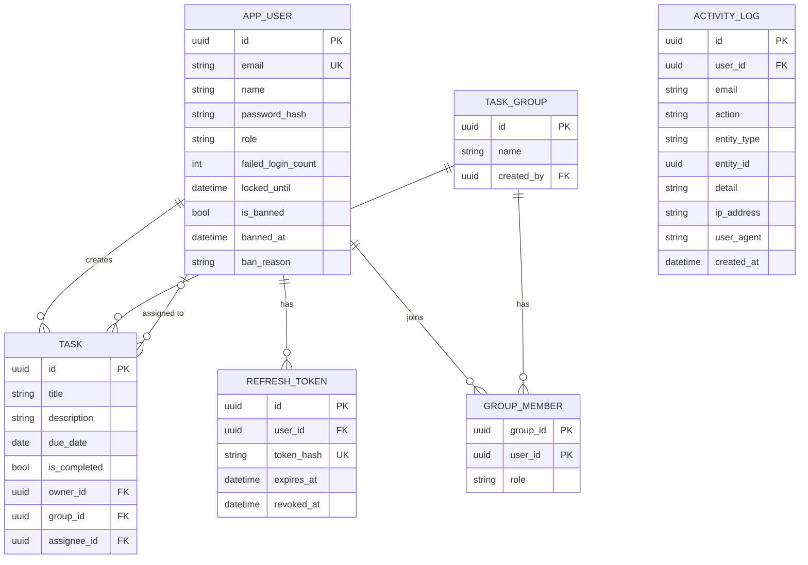
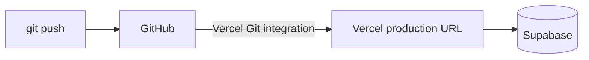

# Technical Design Document (TDD) — Smarter Todo

| Field | Value |
|---|---|
| Product | Smarter Todo |
| Version | MVP + Beta |
| Releases | MVP — Mid-term, Beta — Final |
| Status | Draft |
| Related docs | [Product Requirements Document (PRD)](01-prd.md), [Software Requirements Specification (SRS)](02-srs.md) |

Sections and tables are marked **MVP** or **Beta**. Build the MVP parts for the mid-term; the Beta parts extend them for the final.

**Documents in this set**

| Short form | Full form | Purpose | File |
|---|---|---|---|
| PRD | Product Requirements Document | What we build and why | [01-prd.md](01-prd.md) |
| SRS | Software Requirements Specification | Exact requirements, permissions and acceptance criteria | [02-srs.md](02-srs.md) |
| TDD | Technical Design Document | How we build it: architecture, data model, API (this document) | [03-tdd.md](03-tdd.md) |

## 1. Overview

- **MVP:** a FastAPI REST API for task CRUD, stored in a SQL database through SQLModel, deployed together with the Vite + React frontend as one Vercel project.
- **Beta:** the same app gains users and login (JWT), global roles (`user`/`admin`), groups with per-group roles (`owner`/`member`), and security hardening. Schema changes are managed with Alembic.

## 2. Tech stack

| Layer | Choice | Why | Release |
|---|---|---|---|
| API | FastAPI | Validation, OpenAPI docs and type hints out of the box; already in the repo template | MVP |
| ORM / models | SQLModel | One class works as both the Pydantic schema and the database table; made by the FastAPI author | MVP |
| Database (production) | PostgreSQL on Supabase | Free tier, managed Postgres with a web dashboard (table editor, SQL editor), built-in connection pooler for serverless | MVP |
| DB driver | `psycopg[binary]` (psycopg 3) | Standard Postgres driver for SQLAlchemy/SQLModel | MVP |
| Database (local) | SQLite | No setup needed | MVP |
| Frontend | Vite + React + TypeScript | Already in the repo template | MVP |
| Hosting | Vercel | Frontend and backend in one project (`vercel.json`), auto deploy from GitHub | MVP |
| Migrations | Alembic | Versioned schema changes as the model grows from 1 to 5 tables | Beta |
| JWT | PyJWT | Sign and verify access tokens | Beta |
| Password hashing | `pwdlib[argon2]` | Argon2 hashing, recommended in the FastAPI docs | Beta |

## 3. Architecture



`vercel.json` already routes `/api/*` to the backend service and everything else to the frontend, so every backend route must start with `/api`. For the same reason the API docs are served at `/api/docs` (not FastAPI's default `/docs`):

```python
app = FastAPI(title="Smarter Todo API", docs_url="/api/docs", openapi_url="/api/openapi.json", redoc_url=None)
```

### 3.1 Request flow — MVP



### 3.2 Login and refresh flow — Beta



## 4. Project structure

```
backend/
  main.py              # creates the app, includes each feature's router, health check, serves the frontend build
  app/
    config.py          # settings from env vars (DATABASE_URL, JWT_SECRET, token lifetimes)
    database.py        # engine, get_session(), SessionDep
    security.py        # Argon2 password hashing, JWT create/verify, refresh token create/hash
    errors.py          # AppError (400 / 401 / 409): services raise them, main.py answers with the status code
    clock.py           # utc_now()
    tasks/             # one folder per feature (domain), everything for tasks together
      router.py        # /api/v1/tasks endpoints (APIRouter)
      schemas.py       # TaskCreate / TaskUpdate / TaskRead (request and response shapes)
      models.py        # Task table
      service.py       # TaskService: business rules (no HTTP, no SQL)
      repository.py    # TaskRepository: every database query for tasks
      dependencies.py  # get_task_service (session -> repository -> service) and valid_task: resolves {task_id} to a Task or answers 404
    auth/              # /api/v1/auth/* (signup, login, refresh, logout): router, schemas, models (AppUser, RefreshToken), service, repository, dependencies (get_current_user)
    users/             # /api/v1/users/me (profile, change name, change password): router, schemas, service, dependencies
    admin/             # /api/v1/admin/* (require_permission(ADMIN_*)): router, schemas, service, repository (queries across all users and tasks), dependencies
    rbac/              # roles, permissions, policy engine, permission matrix (policies.py) and require_permission; see section 10.3
    activity/          # activity log: models (ActivityLog), actions (ActivityAction enum), repository, recorder (adds IP and user agent), dependencies (ActivityDep, UserActivityDep), schemas
    groups/            # /api/v1/groups/* (members and group tasks): router, schemas, models (TaskGroup, GroupMember), service, repository, dependencies (get_membership, require_group_permission)
  alembic/             # migration scripts
  alembic.ini          # (Beta)
  requirements.txt
frontend/
  src/
    App.tsx            # routes, Ant Design theme and dark-mode state
    pages/             # HomePage, TaskDetailsPage, AboutPage (Beta: Login, Signup, Groups, Profile, AdminDashboard)
    components/        # TaskForm, TaskList, TaskStats
    layouts/           # AppLayout (navigation, dark-mode switch)
    services/          # api.ts (every backend call)
    types/             # Task, TaskInput, TaskPatch
    utils/             # form helpers and validation rules
docs/
  01-prd.md
  02-srs.md
  03-tdd.md
```

The backend is organised by feature (domain), as recommended for FastAPI projects that will grow: each folder holds its own router, schemas, models, service, repository and dependencies. A **router** parses the request and calls the service; **dependencies** (`Depends`) do the reusable checks, such as loading a task or answering `404`, and later the permission checks, and build the service for each request; the **service** holds the business rules (for example, refreshing `updated_at` on every change) and knows nothing about HTTP or SQL; the **repository** is the only code that talks to the database through the SQLModel session. If the data source changes, only the repository is rewritten and the service stays the same. `main.py` only wires the routers together and adds the catch-all `500` handler.

## 5. Data model

### 5.1 `task` table — MVP

| Column | Type | Rules |
|---|---|---|
| `id` | uuid | Primary key, generated by the app (`uuid4`), so ids are not guessable and not tied to the database |
| `title` | varchar(200) | Not null |
| `description` | varchar(1000) | Nullable |
| `due_date` | date | Nullable |
| `is_completed` | boolean | Not null, default `false` |
| `created_at` | timestamp (UTC) | Not null, set on insert |
| `updated_at` | timestamp (UTC) | Not null, set on insert and every update |



### 5.2 Full data model — Beta

`user` and `group` are reserved words in PostgreSQL, so the tables are named `app_user` and `task_group`.

**`app_user`**

| Column | Type | Rules |
|---|---|---|
| `id` | uuid | Primary key |
| `email` | varchar(254) | Unique, stored lowercase |
| `name` | varchar(100) | Not null |
| `password_hash` | varchar | `v1$` + Argon2 hash (older rows: plain Argon2), never returned by the API |
| `role` | varchar(10) | `user` or `admin`, default `user` |
| `failed_login_count` | integer | Default 0 |
| `locked_until` | timestamp (UTC) | Nullable |
| `is_banned` | boolean | Default `false` |
| `banned_at` | timestamp (UTC) | Nullable |
| `ban_reason` | varchar(500) | Nullable |
| `created_at`, `updated_at` | timestamp (UTC) | Not null |

**`refresh_token`**

| Column | Type | Rules |
|---|---|---|
| `id` | uuid | Primary key |
| `user_id` | uuid | FK → `app_user.id`, on delete cascade |
| `token_hash` | char(64) | SHA-256 of the token, unique |
| `expires_at` | timestamp (UTC) | Not null (now + 7 days) |
| `revoked_at` | timestamp (UTC) | Nullable |
| `created_at` | timestamp (UTC) | Not null |

**Added by migration 0007** (`0007_categories_sessions`)

| Table / column | Type | Rules |
|---|---|---|
| `app_user.last_login_at` | timestamp (UTC) | Nullable; set on every successful login |
| `refresh_token.session_id` | uuid | One per login, kept across rotations; indexed; backfilled for old rows |
| `refresh_token.user_agent`, `ip_address` | varchar(200), varchar(45) | The device that logged in |
| `refresh_token.started_at`, `last_used_at` | timestamp (UTC) | Session start and last refresh |
| `category` | table | `id`, `owner_id` (FK → `app_user`, cascade, indexed), `name` (varchar 50), `created_at`; names are unique per owner ignoring case (checked in the service) |
| `task.category_id` | uuid | FK → `category.id`, `ON DELETE SET NULL`, indexed; personal tasks only |
| `group_member.granted_permissions` | varchar(300) | Comma-separated delegated permissions of a member (`group:tasks:create`, `group:tasks:update`, `group:tasks:assign`); existing members get all three |
| `activity_log.ip_address` | index | `ix_activity_log_ip_address`, for the security report |

**`task_group`**

| Column | Type | Rules |
|---|---|---|
| `id` | uuid | Primary key |
| `name` | varchar(100) | Not null |
| `created_by` | uuid | FK → `app_user.id` |
| `created_at`, `updated_at` | timestamp (UTC) | Not null |

**`group_member`**

| Column | Type | Rules |
|---|---|---|
| `group_id` | uuid | PK part, FK → `task_group.id`, on delete cascade |
| `user_id` | uuid | PK part, FK → `app_user.id`, on delete cascade |
| `role` | varchar(10) | `owner` or `member` |
| `joined_at` | timestamp (UTC) | Not null |

**`task` (new columns in Beta)**

| Column | Type | Rules |
|---|---|---|
| `owner_id` | uuid | FK → `app_user.id`, not null: the user who created the task |
| `group_id` | uuid | FK → `task_group.id`, nullable, on delete cascade. `null` = personal task |
| `assignee_id` | uuid | FK → `app_user.id`, nullable. Only for group tasks; must be a group member |

Indexes: `task(owner_id, group_id)`, `task(group_id)`, `group_member(user_id)`, `refresh_token(user_id)`.



**Activity log (`activity_log`):** one row per thing a user did (FR-42). `user_id` is nullable with `ON DELETE SET NULL` and `email` is a snapshot, so history stays readable if a user is deleted, and a failed login for an unknown email still has a row. `action` is the `ActivityAction` enum value (`login`, `login_failed`, `task_created`, ...). Indexes: `user_id`, `action`, `created_at`. Never store passwords, tokens or hashes in any column. Rows older than `ACTIVITY_RETENTION_DAYS` (default 90, `0` = forever) are deleted by `app/activity/retention.py`, called opportunistically on login at most once an hour; an admin can also purge by hand (`DELETE /api/v1/admin/activity?older_than_days=`).

**Who can see a task:**
- Personal task (`group_id` is null): only `owner_id` (and admins).
- Group task (`group_id` set): every member of that group (and admins).

### 5.3 Schemas

| Schema | Used for | Fields | Release |
|---|---|---|---|
| `TaskCreate` | `POST` task body | `title`, `description?`, `due_date?` (+ `assignee_id?` for group tasks) | MVP |
| `TaskUpdate` | `PATCH` task body | all optional: `title`, `description`, `due_date`, `is_completed` (+ `assignee_id` for group tasks) | MVP |
| `TaskRead` | Task responses | all task columns | MVP |
| `TaskPage` | `GET` task list response | `items: TaskRead[]`, `total`, `offset`, `limit` | MVP |
| `SignupRequest` | Sign up | `email`, `name`, `password` | Beta |
| `LoginRequest` | Log in | `email`, `password` | Beta |
| `TokenResponse` | Login / refresh | `access_token`, `token_type: "bearer"`, `expires_in` | Beta |
| `UserRead` | User responses | `id`, `email`, `name`, `role`, `created_at` (never `password_hash`) | Beta |
| `RoleUpdate` | Change role | `role` | Beta |
| `ProfileUpdate` | Change own name | `name` | Beta |
| `PasswordChange` | Change own password | `current_password`, `new_password` | Beta |
| `AdminUserRead` | Admin user list | `UserRead` + `is_banned`, `banned_at`, `ban_reason` | Beta |
| `BanRequest` | Ban a user | `reason?` | Beta |
| `AdminStats` | Dashboard | `users {total, admins, banned, new_last_7_days}`, `tasks {total, completed, created_last_7_days}`, `groups {total}` | Beta |
| `GroupCreate` / `GroupUpdate` | Create / rename group | `name` | Beta |
| `GroupRead` | Group responses | `id`, `name`, `created_by`, `my_role`, `created_at` | Beta |
| `MemberAdd` | Add member | `email` | Beta |
| `MemberRead` | Member list | `user_id`, `name`, `email`, `role`, `joined_at` | Beta |

MVP sketch:

```python
class TaskBase(SQLModel):
    title: str = Field(min_length=1, max_length=200)
    description: str | None = Field(default=None, max_length=1000)
    due_date: date | None = None

class Task(TaskBase, table=True):
    id: uuid.UUID = Field(default_factory=uuid.uuid4, primary_key=True)
    is_completed: bool = False
    created_at: datetime = Field(default_factory=lambda: datetime.now(timezone.utc))
    updated_at: datetime = Field(default_factory=lambda: datetime.now(timezone.utc))

class TaskCreate(TaskBase): ...

class TaskUpdate(SQLModel):
    title: str | None = Field(default=None, min_length=1, max_length=200)
    description: str | None = Field(default=None, max_length=1000)
    due_date: date | None = None
    is_completed: bool | None = None

class TaskRead(TaskBase):
    id: uuid.UUID
    is_completed: bool
    created_at: datetime
    updated_at: datetime
```

`title` is trimmed before validation so `"   "` is rejected.

## 6. REST API design

Base path: `/api/v1`. All bodies are JSON.

### 6.1 Endpoints — MVP

In the MVP no login is needed. In the Beta the same task endpoints require a token and only work on the caller's personal tasks.

| Method | Path | Body | Success | Errors | FR |
|---|---|---|---|---|---|
| `POST` | `/api/v1/tasks` | `TaskCreate` | `201` `TaskRead` | `409`, `422` | FR-01, FR-07 |
| `GET` | `/api/v1/tasks?offset=0&limit=20` | — | `200` `TaskPage` | `422` | FR-02, FR-03 |
| `GET` | `/api/v1/tasks/{id}` | — | `200` `TaskRead` | `404` | FR-04 |
| `PATCH` | `/api/v1/tasks/{id}` | `TaskUpdate` | `200` `TaskRead` | `404`, `409`, `422` | FR-05, FR-07 |
| `DELETE` | `/api/v1/tasks/{id}` | — | `204` | `404` | FR-06 |
| `GET` | `/api/health` | — | `200` `{"status":"ok"}` | — | FR-10 |

### 6.2 Endpoints — Beta

"Who" uses the roles from the [SRS permission matrix (section 3.9)](02-srs.md#39-permission-matrix--beta). Every endpoint except auth, health and docs needs `Authorization: Bearer <access_token>` (`401` without it).

**Auth and profile**

| Method | Path | Who | Body | Success | Errors | FR |
|---|---|---|---|---|---|---|
| `POST` | `/api/v1/auth/signup` | Guest | `SignupRequest` | `201` `UserRead` | `409`, `422` | FR-12 |
| `POST` | `/api/v1/auth/login` | Guest | `LoginRequest` | `200` `TokenResponse` + cookie | `401`, `429` | FR-13, FR-34 |
| `POST` | `/api/v1/auth/refresh` | Refresh cookie | — | `200` `TokenResponse` + new cookie | `401` | FR-14 |
| `POST` | `/api/v1/auth/logout` | Refresh cookie | — | `204`, cookie cleared | — | FR-15 |
| `GET` | `/api/v1/auth/sessions` | User | — | `200` `SessionRead[]` (marks the current one) | `401` | FR-55 |
| `DELETE` | `/api/v1/auth/sessions/{session_id}` | User | — | `204` | `404` | FR-55 |
| `POST` | `/api/v1/auth/sessions/revoke-others` | User | — | `204` | `401` | FR-55 |
| `POST` | `/api/v1/auth/sessions/revoke-all` | User | — | `204`, cookie cleared | `401` | FR-55 |
| `GET` | `/api/v1/users/me` | User | — | `200` `UserRead` | `401` | FR-16 |
| `PATCH` | `/api/v1/users/me` | User | `ProfileUpdate` | `200` `UserRead` | `422` | FR-40 |
| `POST` | `/api/v1/users/me/password` | User | `PasswordChange` | `204` (all sessions logged out) | `400` (wrong current password), `422` | FR-41 |

**Personal tasks** — same five endpoints as the MVP, now scoped to the caller (`owner_id = me`, `group_id is null`). Other users' tasks return `404` (FR-17 – FR-19). The list accepts `q`, `category_id`, `uncategorized` and `status` (`open` / `done` / `overdue`), built into a frozen dataclass in `app/tasks/filters.py` (FR-54). Create and update accept `category_id`.

**Categories**

| Method | Path | Who | Body | Success | Errors | FR |
|---|---|---|---|---|---|---|
| `GET` | `/api/v1/categories` | User | — | `200` `CategoryRead[]` with `task_count` | `401` | FR-53 |
| `POST` | `/api/v1/categories` | User | `CategoryCreate` | `201` `CategoryRead` | `409` (duplicate, or 30 reached), `422` | FR-53 |
| `PATCH` | `/api/v1/categories/{category_id}` | User | `CategoryUpdate` | `200` `CategoryRead` | `404`, `409`, `422` | FR-53 |
| `DELETE` | `/api/v1/categories/{category_id}` | User | — | `204` (tasks become uncategorized) | `404` | FR-53 |

**Admin**

| Method | Path | Who | Body | Success | Errors | FR |
|---|---|---|---|---|---|---|
| `GET` | `/api/v1/admin/users?offset&limit&q&role&status` | Admin | — | `200` `AdminUserPage` | `403`, `422` | FR-21, FR-39, FR-44 |
| `PATCH` | `/api/v1/admin/users/{user_id}/role` | Admin | `RoleUpdate` | `200` `UserRead` | `400` (own role), `403`, `404` | FR-22 |
| `GET` | `/api/v1/admin/tasks?offset&limit&owner_id&group_id&scope&status&q` | Admin | — | `200` `AdminTaskPage` | `403`, `422` | FR-23, FR-44 |
| `GET` | `/api/v1/admin/groups?offset&limit&owner_id&q` | Admin (`ADMIN_GROUPS_VIEW`) | — | `200` `AdminGroupPage` | `403`, `422` | FR-45 |
| `DELETE` | `/api/v1/admin/tasks/{task_id}` | Admin | — | `204` | `403`, `404` | FR-23 |
| `GET` | `/api/v1/admin/stats` | Admin | — | `200` `AdminStats` | `403` | FR-35 |
| `POST` | `/api/v1/admin/users/{user_id}/ban` | Admin | `BanRequest` | `200` `AdminUserRead` | `400` (self / other admin), `403`, `404` | FR-36 |
| `POST` | `/api/v1/admin/users/{user_id}/unban` | Admin | — | `200` `AdminUserRead` | `403`, `404` | FR-38 |
| `GET` | `/api/v1/admin/activity?offset&limit&user_id&action&q&date_from&date_to` | Admin (`ADMIN_ACTIVITY_VIEW`) | — | `200` `ActivityPage` | `403`, `422` (unknown action, bad date) | FR-42, FR-43 |
| `GET` | `/api/v1/admin/users/{user_id}` | Admin | — | `200` `AdminUserDetail` | `403`, `404` | FR-46 |
| `POST` | `/api/v1/admin/users/{user_id}/revoke-sessions` | Admin | — | `204` | `403`, `404` | FR-46 |
| `POST` | `/api/v1/admin/users/bulk-ban` | Admin | `BulkBan` (`ids` 1–50, `reason?`) | `200` `BulkResult` (`affected`, `skipped`) | `403`, `422` | FR-47 |
| `POST` | `/api/v1/admin/users/bulk-unban` | Admin | `BulkIds` | `200` `BulkResult` | `403`, `422` | FR-47 |
| `POST` | `/api/v1/admin/tasks/bulk-delete` | Admin | `BulkIds` | `200` `BulkResult` | `403`, `422` | FR-47 |
| `GET` | `/api/v1/admin/groups/{group_id}` | Admin | — | `200` `AdminGroupRead` | `403`, `404` | FR-45 |
| `DELETE` | `/api/v1/admin/groups/{group_id}` | Admin (`ADMIN_GROUPS_DELETE`) | — | `204` | `403`, `404` | FR-48 |
| `GET` | `/api/v1/admin/users/export`, `/tasks/export`, `/activity/export` | Admin (`ADMIN_EXPORT`) | same filters as the lists | `200` CSV download | `403`, `422` | FR-49 |
| `DELETE` | `/api/v1/admin/activity?older_than_days=` | Admin (`ADMIN_ACTIVITY_PURGE`) | — | `200` `PurgeResult` | `400` (no value and retention off), `403`, `422` | FR-50 |
| `GET` | `/api/v1/admin/security/report?hours&min_failures` | Admin (`ADMIN_ACTIVITY_VIEW`) | — | `200` `SecurityReport` | `403`, `422` | FR-52 |

Fixed paths such as `/users/export` and `/users/bulk-ban` are declared before the `{user_id}` routes so they are not read as ids. The CSV writer (`app/admin/export.py`) adds a BOM for Excel, prefixes cells starting with `=`, `+`, `-` or `@` with a quote (formula injection) and stops at 10,000 rows.

The admin lists answer with a page (`items`, `total`, `offset`, `limit`), like the task list. `AdminUserRead` is `UserRead` plus `is_banned`, `banned_at`, `ban_reason` and a computed `status` (`active` / `banned`), so the dashboard can show who is banned (FR-39). `AdminTaskRead` is `TaskRead` plus `owner_id`, `owner_email`, `group_id` and `group_name`.

**List filters (FR-44):** every filter is an optional query parameter; they combine with AND and `total` counts the filtered rows. They are small frozen dataclasses built by FastAPI dependencies (`app/admin/filters.py`, `app/activity/filters.py`), and the repositories turn them into `WHERE` clauses, so a new filter means one field, one parameter and one clause. Text search uses a case-insensitive `LIKE` with `%` and `_` escaped. `overdue` means not completed with a due date before today (UTC). `date_from` and `date_to` are inclusive UTC days. The dashboard's user and group pickers search the server as you type (`q`, 20 results).

**Groups**

| Method | Path | Who | Body | Success | Errors | FR |
|---|---|---|---|---|---|---|
| `POST` | `/api/v1/groups` | User | `GroupCreate` | `201` `GroupRead` | `422` | FR-25 |
| `GET` | `/api/v1/groups` | User | — | `200` `GroupRead[]` (my groups) | — | FR-26 |
| `GET` | `/api/v1/groups/{group_id}` | Member | — | `200` `GroupRead` | `404` | FR-33 |
| `PATCH` | `/api/v1/groups/{group_id}` | Owner | `GroupUpdate` | `200` `GroupRead` | `403`, `404` | FR-27 |
| `DELETE` | `/api/v1/groups/{group_id}` | Owner | — | `204` | `403`, `404` | FR-27 |
| `GET` | `/api/v1/groups/{group_id}/members` | Member | — | `200` `MemberRead[]` | `404` | FR-28 |
| `POST` | `/api/v1/groups/{group_id}/members` | Owner | `MemberAdd` | `201` `MemberRead` | `403`, `404`, `409` | FR-28 |
| `DELETE` | `/api/v1/groups/{group_id}/members/{user_id}` | Owner, or the member themself | — | `204` | `400` (owner leaving), `403`, `404` | FR-29 |
| `PATCH` | `/api/v1/groups/{group_id}/members/{user_id}/permissions` | Owner | `MemberPermissionsUpdate` (`permissions: string[]`) | `200` `MemberRead` | `403`, `404`, `422` (not delegable) | FR-57 |
| `GET` | `/api/v1/groups/{group_id}/tasks?offset&limit` | Member | — | `200` `GroupTaskPage` | `404` | FR-30 |
| `POST` | `/api/v1/groups/{group_id}/tasks` | Member with `group:tasks:create` | `GroupTaskCreate` | `201` `GroupTaskRead` | `403`, `404`, `409`, `422` | FR-30, FR-31, FR-57 |
| `GET` | `/api/v1/groups/{group_id}/tasks/{task_id}` | Member | — | `200` `GroupTaskRead` | `404` | FR-30 |
| `PATCH` | `/api/v1/groups/{group_id}/tasks/{task_id}` | Member with `group:tasks:update` (and `group:tasks:assign` to change the assignee) | `GroupTaskUpdate` | `200` `GroupTaskRead` | `403`, `404`, `409`, `422` | FR-30, FR-31, FR-57 |
| `DELETE` | `/api/v1/groups/{group_id}/tasks/{task_id}` | Owner | — | `204` | `403`, `404` | FR-32 |

### 6.3 Examples

Create:

```http
POST /api/v1/tasks
Content-Type: application/json

{ "title": "Read chapter 3", "due_date": "2026-10-20" }
```

```http
201 Created

{
  "id": "3f2b8c1e-6d4a-4b7e-9a35-1c0e8f5d7a92",
  "title": "Read chapter 3",
  "description": null,
  "due_date": "2026-10-20",
  "is_completed": false,
  "created_at": "2026-10-08T10:00:00Z",
  "updated_at": "2026-10-08T10:00:00Z"
}
```

Mark complete:

```http
PATCH /api/v1/tasks/3f2b8c1e-6d4a-4b7e-9a35-1c0e8f5d7a92
Content-Type: application/json

{ "is_completed": true }
```

Log in (Beta):

```http
POST /api/v1/auth/login
Content-Type: application/json

{ "email": "a@x.com", "password": "correct horse battery" }
```

```http
200 OK
Set-Cookie: refresh_token=...; HttpOnly; Secure; SameSite=Strict; Path=/api/v1/auth; Max-Age=604800

{ "access_token": "eyJhbGciOi...", "token_type": "bearer", "expires_in": 300 }
```

### 6.4 Error format

Use FastAPI's default format so there is no custom code to maintain:

```json
{ "detail": "Task not found" }
```

Validation errors (`422`) use FastAPI's built-in list format, which names the failing field:

```json
{ "detail": [ { "loc": ["body", "title"], "msg": "String should have at least 1 character", "type": "string_too_short" } ] }
```

A catch-all exception handler returns `500` with `{"detail": "Internal server error"}` and logs the real error (NFR-07).

The service signals a broken business rule (a due date in the past) by raising `TaskRuleError`; a handler in `main.py` turns it into `409` with `{"detail": "<message>"}`. The service never imports HTTP classes.

### 6.5 Design rules
- Plural nouns for resources (`/tasks`, `/groups`, `/members`), no verbs in paths (except the `auth` actions).
- Nested paths show ownership: a group's tasks live under `/groups/{group_id}/tasks`.
- `PATCH` for partial update; only fields sent are changed (`model_dump(exclude_unset=True)`).
- Lists are ordered by `created_at` descending and take `offset` / `limit`. The MVP task list answers with a `TaskPage` (`items`, `total`, `offset`, `limit`); `total` is a second `COUNT(*)` query, so the client knows when it has reached the last page.
- `404` (not `403`) when the caller is not allowed to know a resource exists; `403` when they can see it but not do the action.
- `/api/v1` prefix so a future `v2` of the API can live next to it.

## 7. Database access

- `database.py` creates one engine from `settings.database_url` (the `DATABASE_URL` env var, defaulting to `backend/smarter_todo.db` locally).
- `get_session()` is a FastAPI dependency that yields a `Session` per request.
- Tables are created and changed only by Alembic (section 12); the app does not call `create_all`. After cloning, run `alembic upgrade head` once (it creates the local SQLite file).
- On Vercel, connect through Supabase's **transaction pooler** (Supavisor, port `6543`), because each serverless function opens its own connections.
- The transaction pooler does not support prepared statements, so the engine is created with `poolclass=NullPool` (the pooler does the pooling) and `connect_args={"prepare_threshold": None}` for psycopg.
- URL format: `postgresql+psycopg://postgres.<project-ref>:<password>@aws-0-<region>.pooler.supabase.com:6543/postgres`.
- Only the Postgres database is used. Supabase Auth, Storage and the auto-generated REST API are not used; login is our own (section 10) and all access goes through our FastAPI backend.
- Row Level Security (RLS) is not used because the browser never talks to Supabase directly; permissions are enforced in FastAPI. Keep the Supabase `anon` and `service_role` keys out of the frontend.

## 8. Configuration

| Variable | Local | Vercel | Release |
|---|---|---|---|
| `DATABASE_URL` | not set (SQLite default) | Supabase transaction pooler URL (port `6543`) | MVP |
| `POSTGRES_URL` | not set | Set by the Supabase integration on Vercel; used when `DATABASE_URL` is not set | MVP |
| `JWT_SECRET` | optional; without it a fixed development value is used | Required: a random 32+ byte secret (`python -c "import secrets; print(secrets.token_urlsafe(48))"`); logging in fails without it | Beta |
| `PASSWORD_PEPPER` | optional; without it a fixed development value is used | Required: a random 32+ byte secret, generated like `JWT_SECRET`; never change it once users exist (it would invalidate their passwords) | Beta |
| `ACCESS_TOKEN_MINUTES` | `5` | `5` | Beta |
| `REFRESH_TOKEN_DAYS` | `7` | `7` | Beta |
| `ACTIVITY_RETENTION_DAYS` | `90` | `90` (`0` keeps the log forever) | Beta |
| `MIGRATION_DATABASE_URL` | not needed | Not on Vercel. Used only on a developer machine to run Alembic against Supabase (session pooler, port `5432`) | MVP |

No secrets are committed. `.env` stays in `.gitignore`.

Supabase setup (one time):
1. Create a project at supabase.com and save the database password.
2. **Connect** -> **Transaction pooler** -> copy the URI, and change the scheme to `postgresql+psycopg://`.
3. In Vercel -> Project -> **Settings** -> **Environment Variables**, add it as `DATABASE_URL`.
4. Add `psycopg[binary]` to `backend/requirements.txt`.

Free-tier Supabase projects pause after a week with no activity; open the dashboard and restore the project before a demo if needed.

## 9. Deployment



- The repo is connected to Vercel through the Vercel GitHub integration (already set up by the template); a push to `main` deploys to production.
- Environment variables from section 8 are set in the Vercel project settings.
- `vercel.json` has a rewrite inside the `frontend` service that sends every path without a file to `index.html`, so reloading `/tasks/<id>` lets React Router handle the route instead of returning a Vercel 404.
- Before merging a change that includes a new migration, run `alembic upgrade head` against Supabase (section 12), then merge so Vercel deploys the matching code.

## 10. Auth and RBAC design — Beta

### 10.1 Tokens

| Token | Format | Lifetime | Where it lives |
|---|---|---|---|
| Access token | JWT, HS256, claims `sub` (user id), `role`, `iat`, `exp` | 5 min | Browser `localStorage` (`smarter_todo_access_token`, stored with its expiry and shared by tabs); sent as `Authorization: Bearer` |
| Refresh token | Random 32 bytes (`secrets.token_urlsafe`) | 7 days | `refresh_token` cookie (`HttpOnly`, `Secure`, `SameSite=Strict`, `Path=/api/v1/auth`); DB keeps only its SHA-256 hash |

- **Refresh rotation:** each refresh revokes the old token and issues a new one. If a revoked token is used again, all of that user's refresh tokens are revoked (it was probably stolen).
- **Logout:** revokes the current refresh token and clears the cookie. The access token simply expires within 5 minutes.
- **Why `localStorage`:** the token survives reloads and is shared by tabs without an extra `/auth/refresh` call. The cost is that a script injected into the page (XSS) can read it, which is why it lives only 5 minutes and the refresh token stays in the `HttpOnly` cookie. Logging out removes it; `services/api.ts` ignores a stored token whose expiry has passed.
- The `role` claim is only informational; permission checks always use the role loaded from the database, so a role change applies on the next request. Group permissions are not in the token either: they live in `group_member.granted_permissions` and are read per request, so the owner can revoke a grant instantly (a JWT cannot be revoked before it expires).
- **Sessions:** every login creates a `session_id` that stays the same when the refresh token rotates. Revoking a session revokes its refresh tokens; its access token stays valid for up to 5 minutes. Reusing a revoked refresh token triggers reuse detection only if its session is still live, so logging out a device is not reported as theft.

### 10.2 Passwords and login lockout

- Hash with `pwdlib` (Argon2). Verify on login; never log or return the hash.
- **Pepper:** before hashing, the password is run through `HMAC-SHA256(PASSWORD_PEPPER, password)`. The stored value is `v1$<argon2 hash>`. The Argon2 salt is random per hash and lives inside the hash string; the pepper lives only in the environment, so a database leak alone is not enough to crack passwords. Hashes without the `v1$` prefix (made before the pepper) still verify and are replaced by a peppered hash on the next successful login. Changing the pepper invalidates every `v1$` hash.
- Unknown email and wrong password both return `401 "Invalid email or password"`, so emails cannot be discovered.
- Wrong password: `failed_login_count += 1`. At 5, set `locked_until = now + 15 min` and reset the count. While `locked_until > now`, login returns `429`. A successful login resets the count. An unknown email never counts, so a stranger cannot lock someone else out by guessing emails.
- Stored in the database (not in memory) because serverless functions do not share memory.

### 10.3 Permission checks (RBAC module)

All role checks go through `backend/app/rbac/`; routers and services never compare role strings.

```
app/rbac/
  roles.py         # SystemRole (user, admin) and GroupRole (owner, member)
  permissions.py   # Permission enum: every action that needs permission
  policy.py        # Policy engine: grant(), grant_if_own(), require(rule), allows(), authorize()
  policies.py      # the permission matrix: SYSTEM_POLICY and GROUP_POLICY (the only place that lists who may do what)
  dependencies.py  # require_permission(Permission.X) for system-level routes
```

`app/groups/dependencies.py` adds `require_group_permission(Permission.X)`, which runs after `get_membership`.

```python
# a route declares the permission it needs
@router.patch("/{group_id}", response_model=GroupRead)
def rename_group(member: Annotated[GroupMember, Depends(require_group_permission(Permission.GROUP_RENAME))], ...): ...

# a service checks a rule that depends on the data (creator-or-owner, owner-or-self)
subject = Subject(user.id, member.role, resource_owner_id=task.owner_id)
GROUP_POLICY.authorize(subject, Permission.GROUP_TASKS_DELETE, "Only the task creator or the group owner can delete it")
```

`get_current_user` (401, banned users 403) and `get_membership` (404 for outsiders so a group's existence is not revealed) stay in the auth and groups dependencies. The role always comes from the database, so a role change applies on the next request.

| Route group | Check |
|---|---|
| `/api/v1/tasks/*`, `/api/v1/users/me/*`, `POST/GET /api/v1/groups` | `get_current_user` |
| `/api/v1/admin/*` | `require_permission(ADMIN_*)` |
| `/groups/{id}/*` | `get_membership`, then `require_group_permission(GROUP_*)` |

**Extending it**

| To add | Do this |
|---|---|
| A new permission | Add it to `Permission`, grant it to roles in `policies.py`, declare it on the route |
| A new role | Add it to `SystemRole` or `GroupRole` and call `.grant(role, ...)` in `policies.py` |
| "Only on your own resource" | `.grant_if_own(role, Permission.X)` and pass `resource_owner_id` in the `Subject` |
| An extra condition (for example a time window or a banned resource) | `.require(Permission.X, lambda subject: ...)`; every rule must pass |
| A new scope (for example teams) | Create another `Policy()` in `policies.py` and a dependency that calls it |

**Group delegation:** `DELEGABLE_GROUP_PERMISSIONS` lists the permissions an owner may hand out (`group:tasks:create`, `group:tasks:update`, `group:tasks:assign`); `DEFAULT_GRANTS` (`app/groups/models.py`) gives a new member all three; `app/groups/grants.py` converts the stored text. `Subject(..., granted=...)` carries the member's grants and `policy.py` allows a permission for a member only if it is in `granted`. Everything else (delete task, rename, add / remove members, manage permissions) is owner-only. `GroupRead.my_permissions` lets the frontend hide what the caller cannot do; the server still enforces it.

Row-level rules that depend on the data are checked inside the service:
- Personal tasks: query with `owner_id == user.id AND group_id IS NULL`; not found → `404`.
- Delete group task: allowed if `task.owner_id == user.id` or membership role is `owner`.
- Remove member: allowed if caller is owner, or `user_id == caller` (leave); owner leaving → `400`.
- Assignee: must exist in `group_member` for that group, otherwise `422`. Removing a member sets their assigned tasks in that group to `assignee_id = null`.
- Change role: `user_id == caller` → `400`.
- Ban: target is the caller or an admin → `400`. Otherwise set `is_banned = true`, `banned_at = now`, `ban_reason`, and revoke all the user's refresh tokens in the same transaction. Unban clears the three fields.
- Login and refresh also reject banned users with `403`.
- Change password: verify `current_password` (`400` if wrong), hash `new_password`, revoke all the user's refresh tokens; the client then logs in again.

### 10.4 Admin dashboard stats

One endpoint, plain `COUNT` queries (no extra tables):

```python
week_ago = datetime.now(timezone.utc) - timedelta(days=7)
stats = AdminStats(
    users={
        "total": count(AppUser),
        "admins": count(AppUser, AppUser.role == "admin"),
        "banned": count(AppUser, AppUser.is_banned),
        "new_last_7_days": count(AppUser, AppUser.created_at >= week_ago),
    },
    tasks={
        "total": count(Task),
        "completed": count(Task, Task.is_completed),
        "created_last_7_days": count(Task, Task.created_at >= week_ago),
    },
    groups={"total": count(TaskGroup)},
)
```

`count(model, *filters)` is a small helper around `select(func.count()).select_from(model).where(*filters)`.

## 11. Security — Beta

| Area | Design |
|---|---|
| Passwords | Argon2 via `pwdlib` with a per-hash salt and a `PASSWORD_PEPPER` (section 10.2), minimum 8 characters |
| Tokens | Section 10.1; `JWT_SECRET` only in env vars |
| Cookies | `HttpOnly`, `Secure`, `SameSite=Strict`, path-limited |
| CORS | Not enabled: frontend and API share the Vercel origin; locally Vite proxies `/api` |
| Security headers | Added for all routes in the top-level `headers` of `vercel.json` (below) |
| Brute force | Login lockout (section 10.2) |
| Attack monitoring | `app/activity/security_log.py` records `auth_rejected` (malformed, forged or badly signed JWT), `access_denied` (`403`) and `token_reuse_detected` with IP and user agent. It is called from the `AppError` handler in `main.py`, so every `401` / `403` and reuse error passes through it. Expired or missing tokens are not logged (normal use), at most 30 events per IP per minute are written, and control characters are replaced so a hostile header cannot forge log lines. `GET /api/v1/admin/security/report` groups failures by IP and account. |
| Abuse of admin tools | Bulk actions are capped at 50 ids, exports at 10,000 rows with CSV formula escaping, and every admin action is itself written to the activity log |
| Injection | SQLModel/SQLAlchemy parameterised queries only |
| Errors | Catch-all handler returns a generic `500`; details only in logs |
| Data exposure | Response schemas (`UserRead`, `TaskRead`) list fields explicitly; `password_hash` and token hashes are never in a response schema |

```json
"headers": [
  {
    "source": "/(.*)",
    "headers": [
      { "key": "X-Content-Type-Options", "value": "nosniff" },
      { "key": "X-Frame-Options", "value": "DENY" },
      { "key": "Referrer-Policy", "value": "strict-origin-when-cross-origin" },
      { "key": "Strict-Transport-Security", "value": "max-age=63072000; includeSubDomains" }
    ]
  }
]
```

## 12. Migrations

- Alembic lives in `backend/alembic/`, with `target_metadata = SQLModel.metadata`. It reads `MIGRATION_DATABASE_URL`, falling back to `DATABASE_URL`.
- Revision `0001_uuid_task_id` (MVP): creates the `task` table (uuid id) on a fresh database, and converts an integer `task.id` to `uuid` on an existing PostgreSQL database. It does nothing when `id` is already `uuid`. Integer id `n` becomes the uuid whose last digits are `n` in hex.
- Revision `0002_auth` (#4): create `app_user` (`id`, `email`, `name`, `password_hash`, `role`, `created_at`, `updated_at`) and `refresh_token`; delete the existing MVP demo tasks (they have no owner); add `task.owner_id` (not null, foreign key to `app_user`, indexed).
- Revision `0003_ban` (#5): `is_banned`, `banned_at` and `ban_reason` on `app_user`.
- Revisions `0004_groups` and `0005_lockout` (#6): `task_group`, `group_member`, `task.group_id` and `task.assignee_id`; then `failed_login_count` and `locked_until` on `app_user`.
- Revision `0006_activity_log` (#32): the `activity_log` table and its indexes.
- Run migrations from a developer machine: `MIGRATION_DATABASE_URL=... alembic upgrade head` (Supabase session pooler, port `5432`), then merge the code. `MIGRATION_DATABASE_URL` wins over `DATABASE_URL`, so never leave it set in a shell where you run local tests.
- Locally, `alembic upgrade head` (with `DATABASE_URL` unset) builds `backend/smarter_todo.db`; run it again after pulling a change that adds a revision.
- Promote the first admin in the Supabase table editor: set `role = 'admin'` on your `app_user` row.

## 13. Risks

| Risk | Mitigation |
|---|---|
| Serverless cold starts make the first request slow | Acceptable; measure NFR-01 excluding cold start |
| Too many DB connections from serverless functions | Use Supabase transaction pooler (port `6543`) with `NullPool` |
| Free-tier project pauses when idle | Check the Supabase dashboard before demos; any API activity keeps it awake |
| Code deployed before its migration ran (or the reverse) | Always run `alembic upgrade head` before merging a migration; keep migrations additive where possible |
| JWT secret leaked | Only in Vercel env vars; rotating it logs everyone out (acceptable) |
| Permission bug exposes another user's data | All permission checks go through the dependencies in section 10.3; review every new route against the [SRS permission matrix](02-srs.md#39-permission-matrix--beta) |
| No automated tests or CI yet | Review each PR manually against the [SRS acceptance criteria](02-srs.md#5-acceptance-criteria); tests and CI are planned after this semester's scope |
